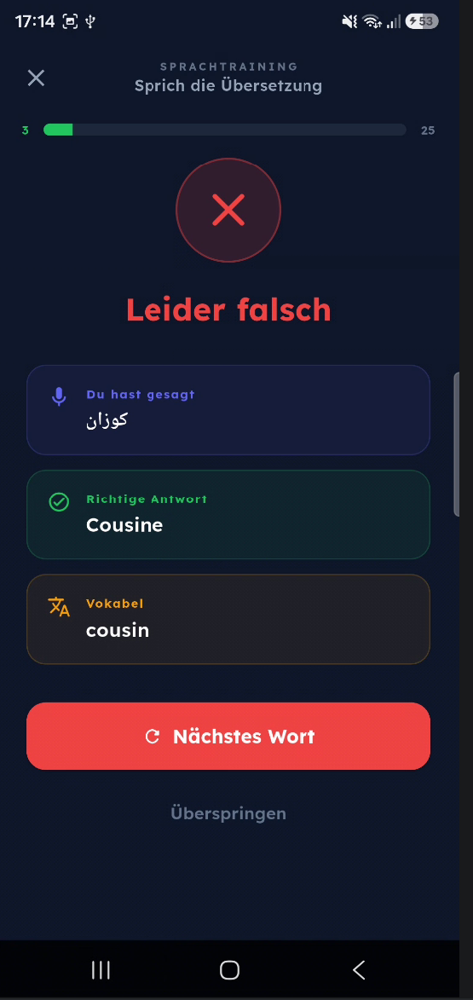
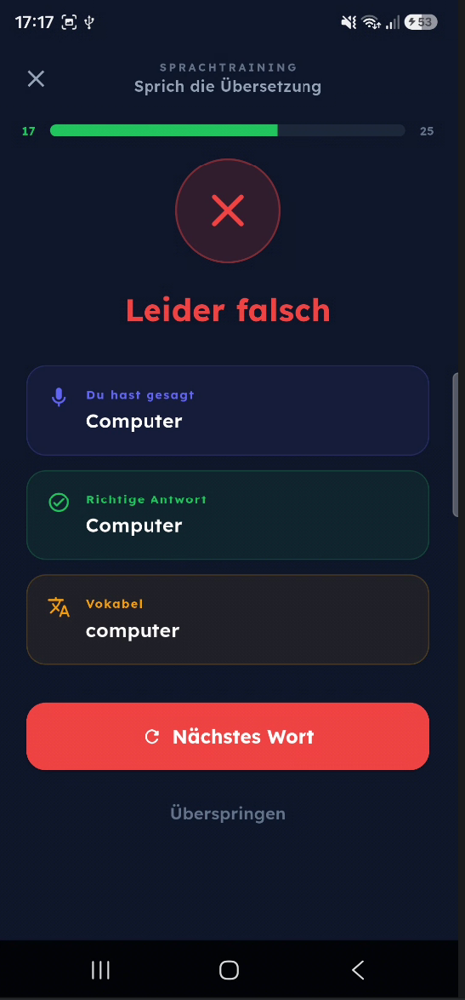
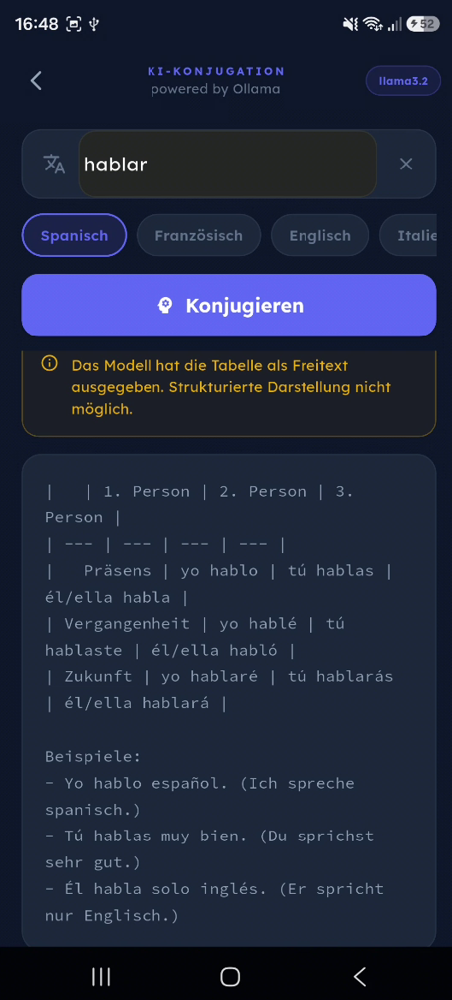

# KI-Vokabeltrainer: Spracherkennung & Gamification

Vokabeltrainer-App mit Flutter, bei der Vokabeln auch per Sprache abgefragt werden können. Spracherkennung (faster-whisper) und Antwortbewertung (Llama 3.2 über Ollama) laufen lokal auf einem eigenen FastAPI-Server, ohne Cloud-Dienste.

## Entstehung: zwei Phasen

| | Phase 1: Teamprojekt | Phase 2: Bachelorarbeit |
| --- | --- | --- |
| Rahmen | Modul *Mobile Applikationen*, FH Südwestfalen | Bachelorarbeit, FH Südwestfalen (2026) |
| Team | 3 Personen | Einzelarbeit (Carlo Iuliano) |
| Inhalt | Karteikarten-Vokabeltrainer mit Flutter und Firebase | Erweiterung um Sprachmodus, KI-Auswertung, Backend und Gamification |

**Phase 1 (Team):** Firebase-Login, Vokabelstapel in Cloud Firestore, Lernmodus mit Stapelsystem nach dem Leitner-Prinzip (`training` → `review` → `mastered`, Rückstufung bei Fehlern), Push-Benachrichtigungen.
Mein Anteil in Phase 1: Kamera-Import mit Texterkennung (Google ML Kit OCR), On-Device-Übersetzung (ML Kit Translation) und die ersten Gamification-Funktionen (XP, Streaks, Liga-Bestenliste).

**Phase 2 (Bachelorarbeit, „KI-Vokabeltrainer mit Flutter: Integration von Spracherkennung und Gamification“):** alles in den folgenden Abschnitten, sofern nicht anders gekennzeichnet. Dieses Repository enthält nur meine Commits; die Basis aus Phase 1 ist im ersten Commit enthalten.

## Funktionen (Phase 2)

### Sprachmodus
- Die App zeigt eine Vokabel, man spricht die Übersetzung ein
- Die Aufnahme (`.m4a`, AAC-LC) wird per HTTP-Multipart an den lokalen Server geschickt und dort mit faster-whisper transkribiert
- Llama 3.2 (3B) prüft, ob die Antwort inhaltlich passt. Dadurch können auch Synonyme oder abweichende Schreibweisen als richtig gewertet werden, was ein reiner Textvergleich nicht leistet
- Das Modell soll in einem festen Format antworten (`KORREKT: ja/nein`, `FEEDBACK: …`). Hält es sich nicht daran, wertet der Server die Antwort über eine einfache Schlagwortprüfung aus, statt einen Fehler zurückzugeben

### Konjugationsmodus
- Ein Verb und eine Sprache eingeben, das LLM liefert eine Konjugationstabelle mit Beispielsätzen
- Wenn die Ausgabe nicht als Tabelle verarbeitet werden kann, zeigt die App den Freitext mit einem Hinweis an

### Gamification
- XP pro abgeschlossener Lerneinheit: `(richtige Antworten * 10).clamp(5, 500)`
- 5 Ligen (Bronze, Silber, Gold, Platin, Diamant), die direkt aus den Gesamt-XP berechnet werden, ohne eigenen gespeicherten Liga-Status
- Tägliche Lernserie (Streak)
- 8 Badges im Katalog, davon 6 mit hinterlegter Freischaltbedingung (Level, Streak, gelernte und gemeisterte Wörter, Lerneinheiten, Sprachen)

### Usability-Studie
Qualitative Studie mit 6 Testpersonen: Ich habe die Personen bei der Nutzung der App beobachtet und sie danach befragt.

## Lokale Verarbeitung
- Audioaufnahmen werden nur an den lokalen Server geschickt, dort als temporäre Datei transkribiert und danach gelöscht
- Spracherkennung und Sprachmodell laufen ohne Cloud-Dienste
- Firebase wird nur für Login und Vokabeldaten genutzt, nicht für Audio

## Architektur

```text
┌─────────────────────────────────┐
│     Smartphone (Flutter-App)    │
│   MVVM · Provider · GoRouter    │
└───────┬─────────────────┬───────┘
        │                 │
   HTTP (REST,       Firebase SDK
   Multipart)             │
        ▼                 ▼
┌─────────────────┐ ┌───────────────────────────┐
│ Lokaler Server  │ │          Firebase         │
│ Python/FastAPI  │ │  Cloud Firestore          │
│ faster-whisper  │ │  Firebase Authentication  │
│ Ollama (LLM)    │ └───────────────────────────┘
└─────────────────┘
```

### Backend-Endpunkte (`backend/app`)

| Endpunkt | Zweck |
| --- | --- |
| `POST /api/transcribe` | Audio-Upload (Multipart), Transkription mit faster-whisper (Modell `small`, CPU, `int8`) |
| `POST /api/chat` | Anfrage an das LLM, Modus `evaluation` (Antwort bewerten) oder `conjugation` (Verb konjugieren) |
| `GET /health` | Erreichbarkeit prüfen |

Anfragen werden mit Pydantic validiert; ungültige Daten lehnt FastAPI mit HTTP 422 ab.

### Projektstruktur (`lib/`)

```text
lib/
├── config/      # Backend-URL und Timeouts (AppConfig)
├── models/      # Datenmodelle (Vocabulary, LeagueModel, BadgeModel, …)
├── providers/   # State-Management (GamificationProvider, SessionProvider, BackendProvider, …)
├── services/    # Backend, Firestore, OCR, Übersetzung, Training
└── ui/          # Screens und Widgets
```

## Tech-Stack

| Bereich | Technologie |
| --- | --- |
| App | Flutter, Dart, Provider, GoRouter |
| Backend | Python, FastAPI, Pydantic |
| Spracherkennung | faster-whisper (CTranslate2) |
| Sprachmodell | Llama 3.2 (3B) über Ollama |
| Daten & Login | Cloud Firestore, Firebase Authentication |
| Phase 1 | Google ML Kit (Texterkennung, Übersetzung) |

## Tests
- Unit-Tests für die Ligagrenzen in `test/league_model_test.dart` (z. B. 999 XP → Bronze, 1000 XP → Silber)
- Timeouts für Backend-Anfragen (60 s Transkription, 30 s Chat); ist der Server nicht erreichbar, wird eine `BackendUnreachableException` geworfen und in der App angezeigt

## Bekannte Grenzen

Die Screenshots stammen aus Tests auf einem echten Gerät und zeigen typische Fehlerfälle:

| Transkription | Bewertung | Konjugation |
| --- | --- | --- |
|  |  |  |
| Whisper hat die Sprache falsch erkannt und arabische Schrift ausgegeben. | Antwort und Lösung sind identisch, das Modell hat trotzdem „falsch“ bewertet. | Das Modell hat keine verwertbare Tabelle geliefert, die App zeigt den Freitext. |

- Ein 3B-Modell bewertet nicht zuverlässig. Für den Praxiseinsatz bräuchte es ein größeres Modell oder einen vorgeschalteten exakten Vergleich.
- Ein Fehler im Backend (der Parameter `Form` wurde aus `tkinter` statt aus FastAPI importiert) hat dazu geführt, dass die Sprachangabe nicht beim Server ankam und Whisper die Sprache selbst erkennen musste. Behoben im Commit `f3fa2e7`.
- Im Stapelsystem aus Phase 1 (`training_service.dart`) werden Wiederholungswörter zwar zuerst eingeordnet, die Liste wird danach aber gemischt. Die beabsichtigte Priorisierung wirkt dadurch nicht.

## Lokales Setup

**Voraussetzungen:** Flutter SDK (≥ 3.11), Python ≥ 3.10, [Ollama](https://ollama.com/) mit `ollama pull llama3.2:3b`, eigenes Firebase-Projekt (Firestore und Authentication)

### Backend starten
```bash
cd backend
python -m venv venv
source venv/bin/activate          # Windows: venv\Scripts\activate
pip install -r requirements.txt
uvicorn app.main:app --host 0.0.0.0 --port 8000 --reload
```

### App starten
1. In `lib/config/app_config.dart` die Backend-URL eintragen
   - Smartphone im selben WLAN: `http://<IP-des-PCs>:8000`
   - Android-Emulator: `http://10.0.2.2:8000`
2. Abhängigkeiten laden und starten
   ```bash
   flutter pub get
   flutter run
   ```

## Autor

**Carlo Iuliano**, B.Sc. Informatik, Fachhochschule Südwestfalen
Bachelorarbeit (2026), Referent: Prof. Dr. Doga Arinir, Korreferent: Prof. Dr. rer. nat. Uwe Klug
